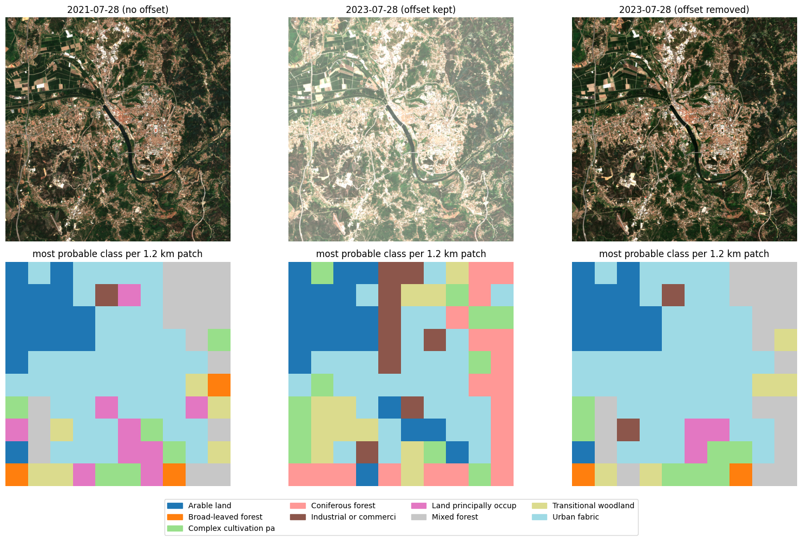

# Sentinel-2 L2A radiometric offset: a hands-on demonstration

Since **processing baseline 04.00 (25 January 2022)**, ESA's Sentinel-2 Level-2A products store reflectance with a **+1000 offset** in every band. A model trained on older, offset-free imagery that receives newer imagery unchanged sees every pixel shifted, and its predictions break.

This repository demonstrates that end to end in one notebook, using an openly available model and real imagery:

1. A model trained only on offset-free L2A data works on a **2021** scene.
2. The same model fails on a **2023** scene of the same place with the **offset kept**.
3. It recovers when the **offset is removed**.
4. A small `harmonize()` function shows how to handle the offset reliably when loading data.



*Coimbra, Portugal, 12 × 12 km, 28 July 2021 and 28 July 2023. Top: true-colour images, all with the same display scaling. Bottom: the model's most probable land-cover class per 1.2 km patch.*

## Result

| Input | Blue-band median (DN) | Label agreement with 2021 |
| --- | --- | --- |
| 2021-07-28 (no offset) | 446 | 1.00 (reference) |
| 2023-07-28 (offset kept) | 1380 | **0.24** |
| 2023-07-28 (offset removed) | 380 | **0.81** |

With the offset kept, forest turns into "Coniferous forest" and "Industrial units" appear across the scene. With it removed, the map is close to 2021; the remaining difference is mostly real change over two years. *Label agreement* is the mean Jaccard overlap between each patch's predicted label set and the 2021 prediction.

## What the offset is

Each Sentinel-2 pixel is stored as an integer **DN** (digital number). The conversion to surface reflectance depends on the product's processing baseline:

| Processing baseline | Reflectance from DN | A surface reflecting 4.5% is stored as |
| --- | --- | --- |
| < 04.00 | DN / 10000 | 450 |
| ≥ 04.00 | (DN − 1000) / 10000 | 1450 |

ESA has also reprocessed older acquisitions with newer baselines, so **a 2021 image can exist both with and without the offset**. Decide from the product's baseline, never from its date.

Normalising inputs with fixed training statistics does not absorb the shift. It turns +1000 DN into a band-dependent shift of about 0.7 to 1.6 standard deviations for this model.

## Not every provider serves the same values

| Provider | 2022+ L2A values as served |
| --- | --- |
| [Copernicus Data Space Ecosystem](https://dataspace.copernicus.eu/) (ESA) | Offset included (original ESA products) |
| [Microsoft Planetary Computer](https://planetarycomputer.microsoft.com/dataset/sentinel-2-l2a) | Offset included |
| [Element 84 Earth Search v1](https://earth-search.aws.element84.com/v1) (AWS) | Offset **already removed** (`earthsearch:boa_offset_applied: true`) |
| [Google Earth Engine](https://developers.google.com/earth-engine/datasets/catalog/COPERNICUS_S2_SR_HARMONIZED) | `S2_SR` keeps it; `S2_SR_HARMONIZED` removes it |

The notebook uses Planetary Computer for the experiment and Earth Search as an independent check of the correction. Removing the offset from data that is already corrected breaks a model just as badly as leaving it in.

## The fix: harmonize when you load the data

Convert every product to one convention (here `reflectance = DN / 10000`) in the single function that reads imagery, before computing statistics, training or inference. Decide per product from its metadata:

```python
def harmonize(dn, item):
    props = item["properties"]
    if props.get("earthsearch:boa_offset_applied"):
        return dn                                # provider already removed it
    if float(props["s2:processing_baseline"]) < 4.0:
        return dn                                # no offset in this product
    return remove_offset(dn, boa_add_offset=-1000)  # keeps nodata (0) as 0
```

ESA states the offset per band as `BOA_ADD_OFFSET` in each product's metadata (`MTD_MSIL2A.xml`). So far it is −1000 for all bands.

## The model

[BigEarthNet v2.0 ResNet-50 (Sentinel-2)](https://huggingface.co/BIFOLD-BigEarthNetv2-0/resnet50-s2-v0.2.0) is a 19-class multi-label land-cover classifier trained on reBEN ([Clasen et al., arXiv:2407.03653](https://arxiv.org/abs/2407.03653)). Its 120 × 120 px patches come from 2017–2018 L2A imagery over 10 European countries. Its training blue-band mean is 438 DN, which confirms the training data had no offset (it would be about 1438 with one). The notebook loads the published weights directly into `timm`, so no training framework is needed.

## Run it

```bash
conda env create -f environment.yml
conda activate s2-offset-demo
jupyter lab s2_l2a_offset_demo.ipynb
```

- Needs internet access: the model weights (about 90 MB) are downloaded from Hugging Face on first run.
- Imagery is streamed from Planetary Computer and Earth Search; nothing is stored locally.
- No accounts or API keys are required.
- Runs on CPU in a few minutes; uses a GPU if one is available.

## Limitations

- One area, two dates, one model.
- There are no ground-truth labels: agreement is measured against the model's own 2021 predictions, so part of the disagreement is real land-cover change.
- A stronger test would add more tiles and dates, or score against CORINE Land Cover.

## Sources

- ESA, [Level-2A Algorithms and Products](https://sentinel.esa.int/web/sentinel/technical-guides/sentinel-2-msi/level-2a-algorithms-products)
- ESA STEP forum, [Introduction of additional radiometric offset in PB04.00 products](https://forum.step.esa.int/t/info-introduction-of-additional-radiometric-offset-in-pb04-00-products/35431)
- Microsoft Planetary Computer, [baseline change example](https://nbviewer.org/github/microsoft/PlanetaryComputerExamples/blob/main/datasets/sentinel-2-l2a/baseline-change.ipynb)
- Clasen et al., [reBEN: Refined BigEarthNet Dataset for Remote Sensing Image Analysis](https://arxiv.org/abs/2407.03653)

Contains modified Copernicus Sentinel data (2021, 2023).
